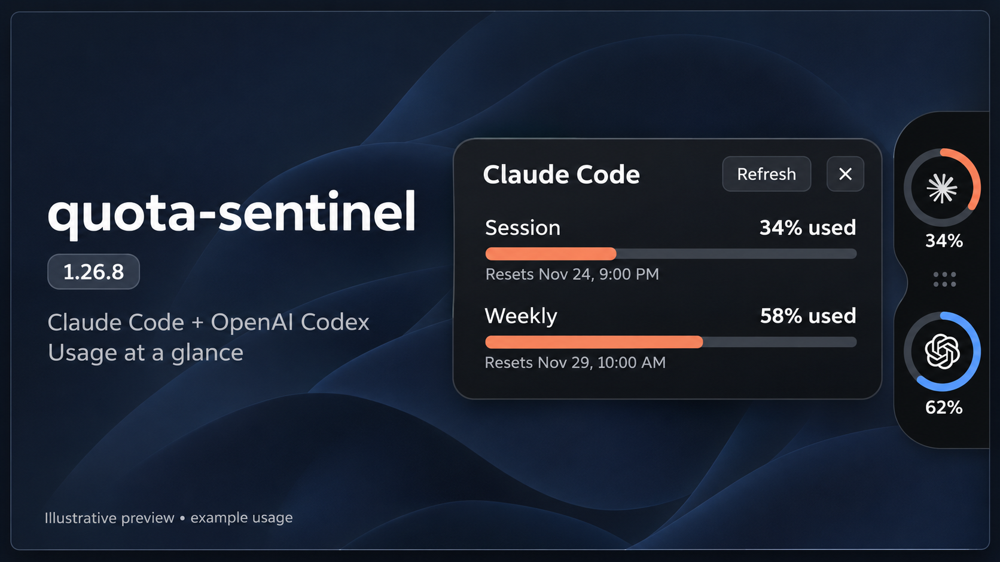

# quota-sentinel



*Illustrative preview with example usage figures.*

An experimental Windows x64 dock for Claude Code and OpenAI Codex usage.

- Hover over the dotted grip to reveal both rings. Drag it to move the dock between screen edges or monitors.
- Hover over a ring to see usage and reset times. Click the orange ring to open Claude Desktop or the blue ring to open ChatGPT Desktop.
- If Windows cannot activate the registered desktop app, choose the matching executable. The launcher saves that path in your local Windows profile.

## Requirements

The Windows x64 installer requires Microsoft Edge WebView2 to be installed. For live usage, sign in through the native Windows Claude Code and Codex CLIs using their default credential locations. The dock shows subscription usage windows where provided. API credits and billing balances are outside the current scope.

## Privacy and provider compatibility

The Rust backend reads the existing CLI sign-in files and sends each credential to its provider's fixed HTTPS usage endpoint. The HTTP client blocks redirects and disables environment proxy discovery. The web interface receives usage percentages, reset times, and status. This prototype excludes transcript tracking, hooks, an updater, and telemetry. The desktop launcher uses Windows app registration or a locally chosen executable path.

Live usage depends on provider endpoints that may change. Review each provider's current authentication and distribution terms before sharing a build with live credential access. Anthropic documents restrictions on third-party use of Claude subscription credentials. [Anthropic authentication and credential-use policy](https://code.claude.com/docs/en/legal-and-compliance)

If Claude usage cannot be refreshed, the dock keeps the last reading in memory and marks it stale. It checks for changes to the Claude Code sign-in file every five seconds and re-reads the current session when it changes. The Refresh button can retry immediately unless the provider has rate-limited the app.

## Build from source

Use Windows x64, the Rust MSVC toolchain, Visual Studio C++ build tools, Node.js with npm, and WebView2. Rust is pinned in `rust-toolchain.toml`.

```powershell
cargo test --release --locked
npx.cmd --yes @tauri-apps/cli@2.11.4 build -- --locked
```

The unsigned installer is generated in `target/release/bundle/nsis/`. Code signing and clean-machine installation testing are pending.

On GitHub, run **Windows build and verification** manually from the Actions tab. A successful run provides separate artifacts for the unsigned standalone EXE and the unsigned installer, each named with the commit SHA and containing its own SHA-256 checksum.

## Source layout

- `src/main.rs` contains the usage clients, parsers, and dock placement.
- `src/launcher.rs` contains native Windows app activation, launching, and file selection.
- `ui/` contains the bundled HTML, CSS, and JavaScript.
- `tauri.conf.json` configures the window, WebView security policy, and installer.

## Attribution

The project derives from [CodeNotch](https://github.com/vinzdg/codenotch), including its Windows prototype and provider artwork. The upstream MIT notice is preserved in [LICENSE](LICENSE). Provider marks identify the corresponding services.
