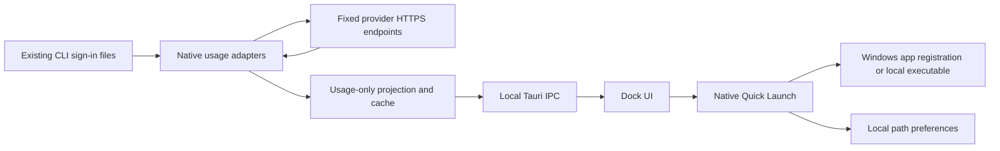

# Architecture

Windows x64; Rust 2021, Tauri 2, WebView2, bundled HTML/CSS/vanilla JavaScript; ureq/TLS, serde, serde_json, chrono and dirs. NSIS packaging is unsigned and requires WebView2.

The usage backend uses existing CLI sign-ins and non-publicly-established account usage interfaces. Supported authentication must be established before distribution. No API billing integration exists. Usage shows percentage used and provider reset times; manual refresh may be stale.

Quick Launch is separate from usage retrieval. The launcher uses fixed PowerShell scripts for Start-menu discovery and file selection, validates app IDs and executable names, and invokes Windows ShellExecute without extra arguments. Locally selected paths are persisted. Publisher signatures are not validated yet.

## Standalone archive layout

- `src/main.rs`: usage clients, parsers, docking and IPC.
- `src/launcher.rs`: app discovery, file selection and launch.
- `ui/`: bundled HTML/CSS/JavaScript.
- `Cargo.toml`, `Cargo.lock`, `build.rs`, `rust-toolchain.toml`: build configuration.
- `tauri.conf.json`, `icons/`: application and installer configuration/assets.

Archive version: 1.26.6. Full repository source migration and independent build verification remain separate from this documentation update.
