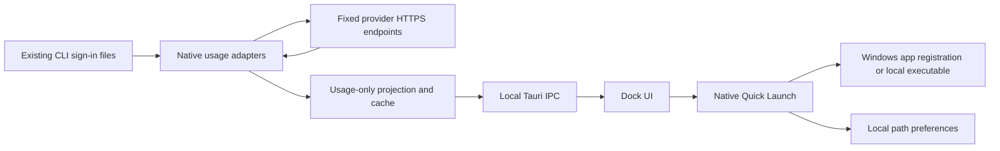

# Architecture

Windows x64; Rust 2021, Tauri 2, WebView2, bundled HTML/CSS/vanilla JavaScript; ureq/TLS, serde, serde_json, chrono and dirs. NSIS packaging is unsigned and requires WebView2.

The usage backend uses existing CLI sign-ins and non-publicly-established account usage interfaces. Supported authentication must be established before distribution. No API billing integration exists. Usage shows percentage used and provider reset times; manual refresh may be stale.

Quick Launch is separate from usage retrieval. The launcher uses fixed Windows application IDs through COM activation, a native file picker, executable-name validation, and Windows ShellExecute without extra arguments. Locally selected paths are persisted. Publisher signatures are not validated yet.

## Source layout

- `src/main.rs`: usage clients, parsers, docking and IPC.
- `src/launcher.rs`: registered app activation, native file selection and launch.
- `ui/`: bundled HTML/CSS/JavaScript.
- `Cargo.toml`, `Cargo.lock`, `build.rs`, `rust-toolchain.toml`: build configuration.
- `tauri.conf.json`, `icons/`: application and installer configuration/assets.

Source version: 1.26.7. The Windows build and verification workflow runs on manual dispatch, tests the locked Rust dependencies and builds separate checksummed unsigned EXE and installer artifacts. Independent build and runtime verification remain pending.
