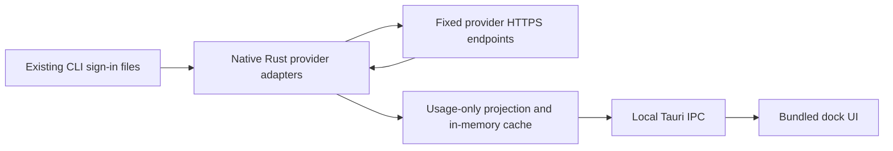

# Architecture

## Prototype baseline

Windows x64; Rust 2021, Tauri 2, WebView2, bundled HTML/CSS/vanilla JavaScript; ureq with TLS, serde, serde_json, chrono and dirs. NSIS packaging is unsigned and requires WebView2. The standalone source migration is outstanding.

## Data flow

The prototype uses existing Claude Code and Codex sign-ins and non-publicly-established account usage interfaces. Supported authentication must be established before distribution; Anthropic subscription credential restrictions require particular review. No API key or billing integration is implemented. The UI shows percentage used and provider-reported reset timestamps; missing windows are not fabricated. Startup and five-minute refresh share a cache, so manual refresh may be stale. Dock placement is not persisted.

## Migration

Extract the usage-only package from the upstream checkout, resolve shared lockfile/icon references, review licensing and artwork, rename application identity and establish an independent build. Proposed layout: src-tauri/, ui/, tests/, docs/ and .github/. No source files are included in this documentation bootstrap.
